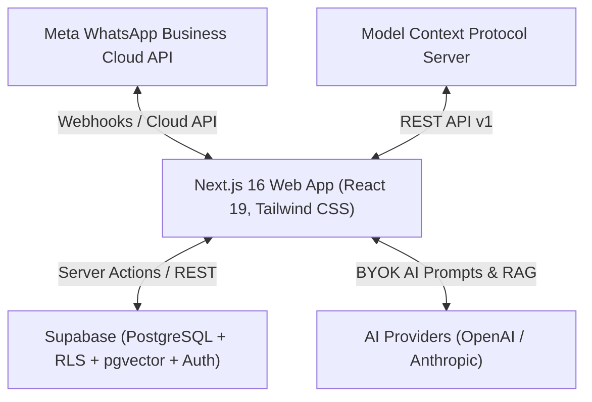

# WABA-CRM — Modern WhatsApp Business API CRM Platform

<p align="center">
  
</p>

<p align="center">
  <strong>Production-ready, self-hostable CRM for the WhatsApp® Business Cloud API built on Next.js 16 and Supabase.</strong>
</p>

<p align="center">
  <a href="https://github.com/shahzebiqbalkhan/Waba-CRM/blob/main/LICENSE">
    
  </a>
  <a href="https://nextjs.org">
    
  </a>
  <a href="https://react.dev">
    
  </a>
  <a href="https://supabase.com">
    
  </a>
  <a href="https://modelcontextprotocol.io">
    
  </a>
  <a href="https://github.com/shahzebiqbalkhan/Waba-CRM/stargazers">
    
  </a>
</p>

---

## Overview

**WABA-CRM** is a full-featured, open-source Customer Relationship Management (CRM) platform engineered specifically for organizations utilizing the official **Meta WhatsApp Business Cloud API**. 

Unlike rigid SaaS alternatives with expensive per-seat pricing models and proprietary lock-in, WABA-CRM gives you complete ownership over your customer data, AI models, conversation histories, and infrastructure.

Designed for high-performance sales, support, and marketing teams, WABA-CRM bridges the gap between customer messaging and sales execution.

---

## ✨ Key Features

### 📥 Multi-Agent Shared Inbox
- **Single Number, Entire Team**: Connect one official WhatsApp Business number and distribute chats across dozens of support agents.
- **Assignment & Real-Time Presence**: Assign conversations to team members, track agent status, and prevent duplicate replies with live typing/viewing indicators.
- **Internal Notes & Customer History**: Leave private internal notes on contact threads visible only to your team.
- **Rich Media & Audio Support**: Full support for images, documents, videos, and native voice notes (Opus recording and playback).

### 🔢 Contact Management & Sequential IDs
- **Sequential Contact Numbers**: Automatic generation of sequential, human-friendly contact identifiers (e.g. `#WABA-00001`).
- **Custom Fields & Tagging**: Categorize leads with multi-colored tags, custom attributes, requirement tracking, and location tags.
- **CSV Import / Export**: Import thousands of contacts with automated header mapping, deduplication, and note attachments.

### ⚡ Visual Automations & Tag Workflows
- **Visual Flow Builder**: Canvas-based workflow engine powered by `@xyflow/react`. Construct automated sequences with triggers, filters, time delays, and actions.
- **Tag Automation Dispatch**: Automatically fire multi-step workflows when specific tags are assigned individually or via bulk CSV actions.
- **Outbound Webhooks**: Dispatch real-time webhooks on inbound messages, deal state transitions, or contact updates to integrate with Zapier, Make, or custom backends.

### 📢 Meta-Approved Broadcasts
- **Official Template Messaging**: Sync and send Meta-approved message templates (Marketing, Utility, Authentication).
- **Dynamic Variable Substitution**: Personalize body, header, and button parameters per recipient.
- **Delivery & Read Analytics**: Live tracking of sent, delivered, read, and failed statuses with error resolution codes.

### 💼 Kanban Sales Pipeline
- **Visual Deal Tracking**: Manage opportunities through customizable pipeline stages with drag-and-drop ease.
- **Direct Conversation Linking**: One-click navigation between deals and active WhatsApp conversation threads.
- **Revenue Forecasting**: Real-time aggregation of deal values and conversion rates.

### 🤖 AI Assistant & Knowledge Base (BYOK)
- **Bring Your Own Key**: Works seamlessly with OpenAI and Anthropic API keys (stored AES-256-GCM encrypted in your database).
- **One-Click Drafts & Auto-Reply**: Generate context-aware reply drafts or deploy an autonomous conversational agent with clean human-handoff safeguards.
- **RAG Knowledge Base**: Upload company documentation, FAQs, and product catalogs. Utilizes hybrid search (PostgreSQL Full-Text Search + `pgvector` semantic embeddings).

### 🔌 Model Context Protocol (MCP) Server
- **AI Agent Integration**: Drive your CRM natively from Claude Desktop, Cursor, ChatGPT, and Windsurf via our built-in MCP server (`mcp-server/`).
- **Granular Safety Controls**: Read-only operations by default, with explicit confirmation required for message dispatch and broadcasts.

---

## 🏗️ Architecture & Tech Stack



- **Frontend / Framework**: Next.js 16 (App Router, Server Actions, React 19)
- **Styling**: Tailwind CSS v4, Lucide Icons, Shadcn UI primitives
- **Database & Auth**: Supabase (PostgreSQL 15+, Row Level Security, Realtime subscriptions, Auth, Storage)
- **Workflow Engine**: Custom DAG execution engine with `@xyflow/react`
- **AI & Vectors**: PostgreSQL `pgvector`, OpenAI / Anthropic APIs
- **Protocol**: Model Context Protocol (MCP) TypeScript SDK

---

## 🚀 Getting Started

### Prerequisites

Ensure you have the following installed:
- [Node.js](https://nodejs.org/) `>= 22.12.0`
- [npm](https://www.npmjs.com/) `>= 10.9.0`
- A [Supabase](https://supabase.com/) project (Cloud or Self-Hosted)
- A [Meta for Developers](https://developers.facebook.com/) account with WhatsApp Cloud API configured

### 1. Clone the Repository

```bash
git clone https://github.com/shahzebiqbalkhan/Waba-CRM.git
cd Waba-CRM
```

### 2. Install Dependencies

```bash
npm install
```

### 3. Configure Environment Variables

Copy the example environment configuration:

```bash
cp .env.local.example .env.local
```

Edit `.env.local` with your credentials:

```ini
# Supabase Configuration
NEXT_PUBLIC_SUPABASE_URL=https://your-project.supabase.co
NEXT_PUBLIC_SUPABASE_ANON_KEY=your-supabase-anon-key
SUPABASE_SERVICE_ROLE_KEY=your-supabase-service-role-key

# Application Settings
NEXT_PUBLIC_APP_URL=http://localhost:3000
ENCRYPTION_SECRET=your-32-byte-hex-secret # Generate with: openssl rand -hex 32

# WhatsApp Webhook Verification
WHATSAPP_WEBHOOK_VERIFY_TOKEN=your-custom-verify-token
```

### 4. Database Migrations

Apply the migration scripts to your Supabase project in order:

```bash
# Option A: Using the Supabase CLI
supabase db push

# Option B: Run the consolidated SQL file in the Supabase SQL Editor
# File: supabase/combined_migrations.sql
```

### 5. Run the Local Development Server

```bash
npm run dev
```

Open [http://localhost:3000](http://localhost:3000) in your browser.

---

## 🐳 Docker Deployment

A production-ready `Dockerfile` and `docker-compose.yml` are included for seamless containerized self-hosting:

```bash
# Build and run with Docker Compose
docker compose up -d --build
```

---

## 🔌 Using the MCP Server

Control your CRM directly from AI environments like Claude Desktop or Cursor:

```jsonc
{
  "mcpServers": {
    "waba-crm": {
      "command": "npx",
      "args": ["-y", "waba-crm-mcp"],
      "env": {
        "WACRM_BASE_URL": "https://your-waba-crm-domain.com",
        "WACRM_API_KEY": "wacrm_live_xxxxxxxxxxxxxxxxxxxxxx",
        "WACRM_ENABLE_WRITES": "true"
      }
    }
  }
}
```

See [docs/mcp.md](./docs/mcp.md) for full tool references and configurations.

---

## 🔒 Security & Data Privacy

- **Data Ownership**: All customer records, phone numbers, and chat logs reside in your Supabase database.
- **Row Level Security (RLS)**: Enforced across 100% of tables with strict tenant isolation.
- **Credential Encryption**: API keys and Meta access tokens are encrypted with `AES-256-GCM` before persisting.
- **Webhook Verification**: Meta inbound webhook payloads are cryptographically validated using HMAC SHA-256 signatures.

---

## 🤝 Contributing

Contributions, issues, and feature requests are welcome! Feel free to check the [issues page](https://github.com/shahzebiqbalkhan/Waba-CRM/issues).
Please read our [Contributing Guide](./CONTRIBUTING.md) before submitting pull requests.

---

## 📄 License

This project is open-source software licensed under the [MIT License](./LICENSE).

---

## 👤 Author & Maintainer

**Shahzeb Iqbal Khan**
- GitHub: [@shahzebiqbalkhan](https://github.com/shahzebiqbalkhan)
- Email: `shazepaperkhan@gmail.com`
